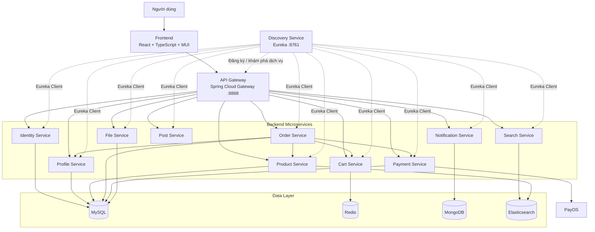
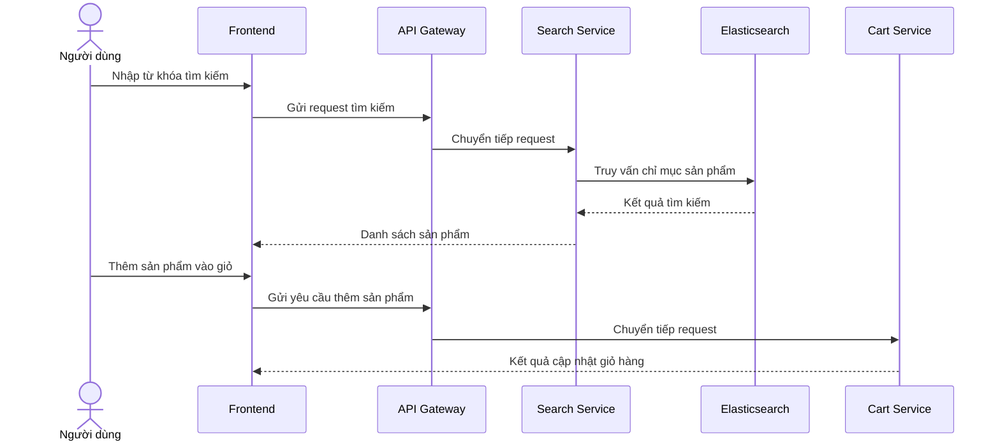
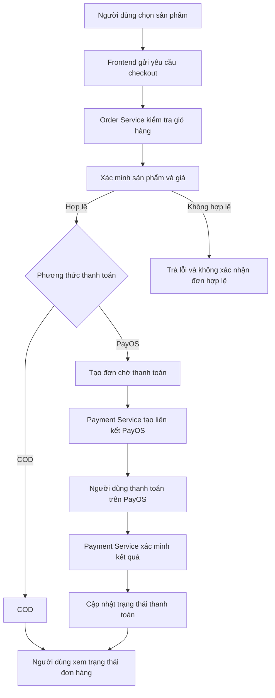
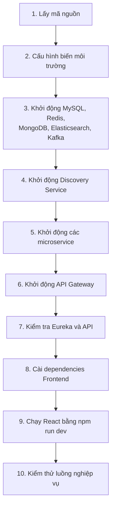

# SHOP-MEAL

**Hệ thống đặt món ăn trực tuyến xây dựng theo kiến trúc Microservices**

Shop-Meal là hệ thống đặt món ăn trực tuyến cho phép người dùng tìm kiếm sản phẩm, quản lý giỏ hàng, đặt hàng, thanh toán trực tuyến và theo dõi đơn hàng. Hệ thống được xây dựng theo kiến trúc Microservices, sử dụng Spring Boot cho Backend và React + TypeScript cho Frontend.

## 1. Architecture tổng thể

### 1.1. Kiến trúc hệ thống

Shop-Meal được tổ chức thành các lớp chính:

- **Presentation Layer:** Giao diện người dùng được xây dựng bằng React + TypeScript.
- **API Gateway Layer:** Tiếp nhận request từ frontend và định tuyến đến các microservice.
- **Service Layer:** Các microservice đảm nhiệm từng nghiệp vụ độc lập.
- **Service Discovery Layer:** Eureka hỗ trợ đăng ký và khám phá dịch vụ.
- **Data Layer:** Các hệ quản trị dữ liệu phù hợp với từng service.
- **External Services:** PayOS phục vụ thanh toán trực tuyến và các hệ thống tích hợp khác.

### 1.2. Sơ đồ kiến trúc tổng thể



*Lưu ý: Sơ đồ thể hiện kiến trúc logic mục tiêu. Kết nối dữ liệu và giao tiếp giữa các service cần được đối chiếu với cấu hình thực tế của từng module. Eureka chỉ hỗ trợ khám phá dịch vụ, không trực tiếp xử lý request nghiệp vụ.*

### 1.3. Vai trò các thành phần

| Thành phần | Vai trò |
|---|---|
| Frontend | Giao diện tìm kiếm món ăn, giỏ hàng, đặt hàng và quản lý tài khoản |
| API Gateway | Điểm truy cập tập trung, định tuyến và áp dụng các chính sách bảo vệ API |
| Discovery Service | Đăng ký và khám phá các microservice bằng Eureka |
| Identity Service | Đăng ký, đăng nhập và xác thực người dùng |
| Profile Service | Quản lý hồ sơ và thông tin người dùng |
| Product Service | Quản lý món ăn, giá và thông tin sản phẩm |
| Search Service | Tìm kiếm sản phẩm bằng Elasticsearch |
| File Service | Xử lý tải lên và cung cấp hình ảnh |
| Notification Service | Quản lý và gửi thông báo theo chức năng được triển khai |
| Cart Service | Quản lý giỏ hàng và các sản phẩm được chọn |
| Post Service | Quản lý bài viết liên quan đến sản phẩm |
| Order Service | Tạo đơn hàng và quản lý vòng đời đơn hàng |
| Payment Service | Quản lý giao dịch và tích hợp PayOS |

### 1.4. Công nghệ sử dụng

| Nhóm | Công nghệ |
|---|---|
| Backend | Java, Spring Boot |
| Microservices | Spring Cloud, OpenFeign |
| Service Discovery | Netflix Eureka |
| API Gateway | Spring Cloud Gateway |
| Bảo mật | Spring Security, JWT |
| ORM | Spring Data JPA, Hibernate |
| Cơ sở dữ liệu quan hệ | MySQL |
| Cache / giỏ hàng | Redis |
| Cơ sở dữ liệu tài liệu | MongoDB |
| Tìm kiếm | Elasticsearch |
| Giao tiếp bất đồng bộ | Apache Kafka, ở các luồng đã tích hợp |
| Thanh toán | PayOS |
| Frontend | React, TypeScript, Vite |
| UI | Material UI (MUI) |
| HTTP Client | Axios |
| Build Backend | Maven |
| Build Frontend | npm |

## 2. Sơ đồ luồng nghiệp vụ

### 2.1. Luồng tìm kiếm và lựa chọn sản phẩm



### 2.2. Luồng đặt hàng và thanh toán



**Nguyên tắc quan trọng:** Backend phải tự tính lại tổng tiền, xác minh dữ liệu đơn hàng và xác thực kết quả thanh toán. Frontend không được tự quyết định đơn hàng đã thanh toán thành công.

## 3. Yêu cầu cần đạt được của dự án

### 3.1. Yêu cầu chức năng

- Người dùng có thể đăng ký, đăng nhập và đăng xuất.
- Người dùng có thể xem, tìm kiếm và xem chi tiết món ăn.
- Người dùng có thể thêm, cập nhật số lượng và xóa sản phẩm trong giỏ hàng.
- Người dùng có thể đặt hàng và lựa chọn phương thức thanh toán được hỗ trợ.
- Hệ thống hỗ trợ quy trình thanh toán PayOS khi được cấu hình đầy đủ.
- Người dùng có thể xem lịch sử và chi tiết đơn hàng của mình.
- Hệ thống quản lý trạng thái đơn hàng và trạng thái thanh toán riêng biệt.
- Người dùng có thể quản lý hồ sơ theo các quyền được cấp.
- Hệ thống hỗ trợ quản lý bài viết, hình ảnh và thông báo theo phạm vi đã triển khai.
- Nhân viên hoặc quản trị viên có thể thực hiện các thao tác nghiệp vụ theo quyền hạn.

### 3.2. Yêu cầu phi chức năng

**Bảo mật**
- Xác thực request được bảo vệ bằng JWT.
- Kiểm tra quyền truy cập ở backend.
- Người dùng không được xem hoặc sửa dữ liệu thuộc người khác nếu không có quyền.
- Không lưu khóa API, mật khẩu hoặc secret trong mã nguồn công khai.
- Xác minh tính hợp lệ của webhook thanh toán.

**Tính nhất quán dữ liệu**
- Tính toán giá và tổng tiền tại backend.
- Lưu thông tin sản phẩm tại thời điểm đặt hàng.
- Xử lý yêu cầu thanh toán lặp một cách an toàn.
- Có phương án xử lý khi giao tiếp giữa các microservice thất bại.

**Khả năng bảo trì và mở rộng**
- Phân chia nghiệp vụ thành các microservice.
- Quản lý cấu hình theo môi trường.
- Tổ chức mã nguồn rõ ràng, dễ kiểm thử và mở rộng.
- Có thể triển khai nhiều instance cho các service khi cần.

**Trải nghiệm người dùng**
- Giao diện dễ sử dụng và tương thích với nhiều kích thước màn hình.
- Có thông báo rõ ràng khi request đang xử lý, thành công hoặc thất bại.
- Các trang cần xác thực được bảo vệ phù hợp.
- Hiển thị trạng thái đơn hàng và thanh toán từ backend.

### 3.3. Tiêu chí nghiệm thu tổng thể

- [ ] Backend khởi động được với cấu hình môi trường hợp lệ.
- [ ] Các microservice đã cấu hình Eureka đăng ký thành công.
- [ ] API Gateway định tuyến request đúng.
- [ ] Các API chính hoạt động và có kiểm tra xác thực, phân quyền.
- [ ] Frontend kết nối được với API Gateway.
- [ ] Người dùng thực hiện được luồng đăng nhập, tìm kiếm và quản lý giỏ hàng.
- [ ] Tạo đơn COD thành công với dữ liệu hợp lệ.
- [ ] Luồng PayOS hoạt động trong môi trường được cấu hình và kiểm thử.
- [ ] Trạng thái thanh toán chỉ được cập nhật sau khi xác minh.
- [ ] Các tình huống lỗi và dữ liệu không hợp lệ được xử lý phù hợp.
- [ ] Frontend build thành công cho môi trường production.
- [ ] README và cấu hình chạy dự án được cập nhật.

## 4. Yêu cầu môi trường

Trước khi chạy Shop-Meal, cần chuẩn bị:

- Git.
- JDK đúng phiên bản dự án yêu cầu.
- Maven hoặc Maven Wrapper (`mvnw`) đi kèm dự án.
- Node.js và npm.
- Các dịch vụ hạ tầng theo cấu hình thực tế: MySQL, Redis, MongoDB, Elasticsearch và Kafka nếu các module đang sử dụng.
- Các biến môi trường cần thiết cho kết nối database, Eureka, Kafka, Elasticsearch, JWT và PayOS.

Kiểm tra phiên bản công cụ:

```bash
java -version
mvn -version
node -v
npm -v
git --version
```

Nếu repository có Maven Wrapper, ưu tiên sử dụng `./mvnw` để dùng phiên bản Maven đã cấu hình cho dự án.

## 5. Cách chạy Backend

### 5.1. Lấy mã nguồn

```bash
git clone <REPOSITORY_URL>
cd shop-meal
```

Thay `<REPOSITORY_URL>` bằng địa chỉ repository thực tế.

Nếu đã có mã nguồn trên máy, chỉ cần chuyển đến thư mục dự án:

```bash
cd ~/Documents/backend/shop-meal
```

### 5.2. Khởi động hạ tầng

Khởi động các dịch vụ hạ tầng mà project đang sử dụng:

- MySQL.
- Redis.
- MongoDB.
- Elasticsearch.
- Kafka và các thành phần liên quan nếu cần.

Nếu repository có file `docker-compose.yml` hoặc `compose.yaml` dành cho hạ tầng, kiểm tra nội dung và sử dụng file đó:

```bash
docker compose up -d
docker compose ps
```

Chỉ chạy lệnh này tại thư mục chứa file Compose phù hợp. Nếu Compose chỉ khai báo một phần hạ tầng, các thành phần còn lại cần được khởi động riêng.

### 5.3. Cấu hình môi trường

Kiểm tra các file `application.yml`, `application.properties` và các cấu hình theo profile của từng service.

Cần xác nhận tối thiểu:

- Thông tin kết nối database.
- Địa chỉ Eureka Server.
- Địa chỉ Redis, MongoDB, Elasticsearch và Kafka.
- Các khóa JWT hoặc cấu hình xác thực.
- Các thông tin PayOS nếu muốn kiểm thử thanh toán.
- Các port và context path của từng service.

Không commit file chứa secret hoặc thông tin xác thực thật lên Git.

### 5.4. Thứ tự khởi động Backend

Khởi động các service theo thứ tự gợi ý:

1. Hạ tầng dữ liệu và message broker.
2. Discovery Service.
3. Các service nghiệp vụ: Identity, Profile, Product, File, Notification, Search, Cart và Post.
4. Payment Service.
5. Order Service.
6. API Gateway.

Thứ tự này giúp giảm lỗi do service gọi đến thành phần chưa sẵn sàng. Một số module có thể khởi động song song nếu dependency đã hoạt động.

### 5.5. Chạy từng Spring Boot service

Mở terminal tại thư mục của service cần chạy.

Nếu có Maven Wrapper:

```bash
chmod +x mvnw
./mvnw spring-boot:run
```

Hoặc nếu đã cài Maven tương thích:

```bash
mvn spring-boot:run
```

Có thể build module trước khi chạy:

```bash
./mvnw clean package
```

Nếu dự án sử dụng Maven parent ở thư mục gốc và cấu hình multi-module, kiểm tra `pom.xml` trước khi build toàn bộ repository. Nếu mỗi service là một project Maven riêng, thực hiện lệnh trong thư mục của từng service.

### 5.6. Kiểm tra sau khi khởi động

| Thành phần | Địa chỉ tham khảo |
|---|---|
| Discovery Service | `http://localhost:8761` |
| API Gateway | `http://localhost:8888` |
| Identity Service | Theo cấu hình service |
| Product Service | Theo cấu hình service |
| Search Service | Theo cấu hình service |
| Order Service | Theo cấu hình service |
| Payment Service | Theo cấu hình service |

Đối chiếu port và context path trong file cấu hình thực tế. Nếu API được gọi thông qua Gateway, hãy sử dụng URL và prefix mà Gateway đã khai báo thay vì suy ra endpoint chỉ từ port của service.

Sau khi khởi động, kiểm tra dashboard Eureka và gửi thử các request API bằng Postman.

## 6. Cách chạy Frontend React + TypeScript

### 6.1. Di chuyển đến thư mục frontend

```bash
cd ~/Documents/backend/shop-meal/web-app
```

Nếu frontend nằm ở vị trí khác, hãy dùng đường dẫn tương ứng với repository.

### 6.2. Cài đặt dependencies

```bash
npm install
```

Nếu repository có `package-lock.json`, có thể dùng `npm ci` để cài đặt theo lockfile:

```bash
npm ci
```

Chỉ sử dụng `npm ci` khi lockfile hiện có đồng bộ với `package.json`.

### 6.3. Cấu hình biến môi trường

Tạo file `.env` trong thư mục frontend theo các biến mà mã nguồn hiện tại sử dụng.

Ví dụ:

```env
VITE_API_BASE_URL=http://localhost:8888/api/v1
```

Đường dẫn trên là ví dụ. Hãy đối chiếu với `vite.config.ts`, cấu hình Axios và route của API Gateway để xác định base URL đúng.

Lưu ý: biến có tiền tố `VITE_` được đưa vào mã frontend khi build. Không đặt mật khẩu database, API key bí mật hoặc secret của PayOS trong file `.env` frontend.

### 6.4. Chạy chế độ phát triển

```bash
npm run dev
```

Vite sẽ hiển thị địa chỉ truy cập trong terminal, thường là:

`http://localhost:5173`

Sử dụng đúng địa chỉ mà terminal hiển thị nếu port mặc định đã được sử dụng.

### 6.5. Build Frontend

Kiểm tra các script có trong `package.json`, sau đó chạy:

```bash
npm run build
```

Nếu dự án có script kiểm tra kiểu dữ liệu riêng, chạy thêm script tương ứng, ví dụ:

```bash
npx tsc --noEmit
```

Lệnh này chỉ phù hợp nếu cấu hình TypeScript hiện tại hỗ trợ kiểm tra theo cách đó.

## 7. Trình tự chạy toàn bộ hệ thống



Sau khi hệ thống sẵn sàng, thực hiện kiểm thử theo thứ tự:

1. Truy cập frontend.
2. Đăng ký hoặc đăng nhập.
3. Xem và tìm kiếm sản phẩm.
4. Thêm sản phẩm vào giỏ hàng.
5. Tạo đơn hàng COD.
6. Thử quy trình PayOS trong môi trường đã cấu hình.
7. Kiểm tra lịch sử đơn hàng và trạng thái thanh toán.

## 8. Lưu ý khi phát triển và triển khai

- Giữ thống nhất tên service giữa Eureka, Gateway và OpenFeign.
- Đảm bảo mỗi service sử dụng đúng database hoặc kho dữ liệu theo thiết kế.
- Không phụ thuộc vào việc người dùng chỉ thao tác qua giao diện để bảo vệ dữ liệu; mọi API cần kiểm tra quyền ở backend.
- Không đánh dấu thanh toán thành công chỉ dựa trên redirect từ PayOS.
- Không lưu secret trong repository hoặc bundle frontend.
- Cấu hình CORS, HTTPS và các chính sách bảo mật phù hợp trước khi triển khai production.
- Kiểm tra các biến môi trường và dependency trước khi xử lý lỗi khởi động.
- Thường xuyên cập nhật tài liệu khi API, port hoặc luồng nghiệp vụ thay đổi.

## 9. Lưu ý khi làm việc

- Mọi người làm việc theo task được giao trước khi làm tạo một brand có tên theo kiểu : ``` Ten-task-1 ``` sau khi làm xong commit và push lên github có thể mỗi lần commit github sẽ yêu cầu tạo pull request bạn bấm chọn ``` create pull request ``` sau khi push lên github xong sẽ commit và merge brand vào brand ``` master``` 

## 10. Kết luận

Shop-Meal áp dụng kiến trúc Microservices nhằm phân tách các nghiệp vụ thành những thành phần độc lập, dễ phát triển và bảo trì. Eureka hỗ trợ khám phá dịch vụ, API Gateway cung cấp điểm truy cập tập trung, các microservice xử lý nghiệp vụ và quản lý dữ liệu, còn React + TypeScript cung cấp giao diện tương tác cho người dùng.

Mục tiêu cuối cùng là xây dựng một hệ thống đặt món ăn có quy trình mua hàng rõ ràng, bảo mật phù hợp, dữ liệu nhất quán và khả năng mở rộng khi bổ sung tính năng mới.

---

# 11. Hướng dẫn chạy toàn bộ dự án bằng Docker

Phần này hướng dẫn build và chạy Shop Meal gồm frontend, các Spring Boot microservice và các thành phần hạ tầng bằng Docker Compose. Các lệnh được thực hiện tại thư mục gốc `Internship-major`, nơi chứa `pom.xml`, `Dockerfile` và `docker-compose.yaml`.

## 11.1. Kiến trúc triển khai Docker

Docker Compose khởi chạy các thành phần sau:

**Frontend**

- `web-app`: React + TypeScript + Vite, build thành static files và phục vụ bằng Nginx.

**Backend – Spring Boot**

- `discovery-service`: Eureka Service Discovery.
- `api-gateway`: cổng vào tập trung cho frontend.
- `identity-service`: xác thực và quản lý danh tính.
- `profile-service`: quản lý hồ sơ người dùng.
- `notification-service`: xử lý thông báo.
- `post-service`: quản lý bài viết.
- `file-service`: quản lý file và hình ảnh.
- `product-service`: quản lý sản phẩm.
- `search-service`: tìm kiếm sản phẩm.
- `cart-service`: quản lý giỏ hàng.
- `order-service`: quản lý đơn hàng và Socket.IO.
- `payment-service`: xử lý thanh toán.

`contract-service` là Maven module dùng chung, được Maven build cùng service phụ thuộc; module này không chạy thành container riêng.

**Infrastructure**

- Apache Kafka
- MySQL
- MongoDB
- Redis
- Elasticsearch
- MinIO

## 11.2. Yêu cầu môi trường

Cài đặt và khởi động Docker Engine hoặc Docker Desktop, đồng thời bảo đảm có Docker Compose V2.

Kiểm tra phiên bản:

```bash
docker --version
docker compose version
```

Khuyến nghị máy có tối thiểu 8 GB RAM dành cho Docker khi build và chạy toàn bộ hệ thống. Build lần đầu có thể mất thời gian do Maven và npm phải tải dependencies.

Trên Ubuntu/Linux, Elasticsearch yêu cầu `vm.max_map_count` tối thiểu là `262144`.

Thiết lập tạm thời:

```bash
sudo sysctl -w vm.max_map_count=262144
```

Thiết lập lâu dài sau khi khởi động lại máy:

```bash
echo 'vm.max_map_count=262144' | sudo tee /etc/sysctl.d/99-elasticsearch.conf
sudo sysctl --system
```

## 11.3. Chuẩn bị mã nguồn và biến môi trường

Mở terminal tại thư mục gốc dự án:

```bash
cd Internship-major
```

Tạo file `.env` từ file mẫu:

```bash
cp .env.docker.example .env
```

Mở `.env` và điều chỉnh các biến cần thiết:

```dotenv
# MySQL
MYSQL_ROOT_PASSWORD=123456
MYSQL_USERNAME=root
MYSQL_PASSWORD=123456

# MongoDB
MONGO_ROOT_USERNAME=root
MONGO_ROOT_PASSWORD=123456

# JWT – thay bằng chuỗi bí mật đủ mạnh
SIGNER_KEY=change-this-development-jwt-key-before-deploying-1234567890
VALID_DURATION=3600
REFRESHABLE_DURATION=604800

# Google OAuth – để trống nếu chưa sử dụng đăng nhập Google
GOOGLE_CLIENT_ID=
GOOGLE_CLIENT_SECRET=
GOOGLE_REDIRECT_URL=http://localhost:3000/authenticate

# Email Brevo – để trống nếu chưa sử dụng gửi email
API_KEY_BREVO=

# PayOS – điền thông tin thật nếu kiểm thử thanh toán trực tuyến
PAYOS_CLIENT_ID=
PAYOS_API_KEY=
PAYOS_CHECKSUM_KEY=
PAYOS_RETURN_URL=http://localhost:3000/payment/success
PAYOS_CANCEL_URL=http://localhost:3000/payment/cancel

# Elasticsearch local development
ELASTIC_PASSWORD=123456

# MinIO
MINIO_ROOT_USER=admin
MINIO_ROOT_PASSWORD=12345678
MINIO_BUCKET=shop-meal

# Frontend – các biến VITE được nhúng vào bundle lúc build
VITE_API_BASE_URL=http://localhost:8888/api/v1
VITE_SOCKET_URL=http://localhost:8099
VITE_GOOGLE_CLIENT_ID=
VITE_GOOGLE_REDIRECT_URI=http://localhost:3000/authenticate

# Kafka: địa chỉ quảng bá cho ứng dụng chạy ngoài Docker
KAFKA_EXTERNAL_HOST=localhost
```

Các giá trị trên chỉ phục vụ môi trường local development. Không sử dụng mật khẩu mẫu, JWT secret mẫu hoặc để lộ API key khi triển khai trên máy chủ công khai. Không commit file `.env` lên Git.

Nếu không sử dụng Google OAuth, Brevo hoặc PayOS ở giai đoạn chạy thử, có thể để trống các biến tương ứng. Các chức năng phụ thuộc những dịch vụ này sẽ không hoạt động đầy đủ cho đến khi được cấu hình.

## 11.4. Kiểm tra cấu hình Docker Compose

Trước khi build, kiểm tra cấu hình và biến môi trường:

```bash
docker compose -f docker-compose.yaml config
```

Nếu lệnh báo thiếu biến môi trường, kiểm tra đã tạo `.env` từ `.env.docker.example` và đang chạy lệnh tại đúng thư mục gốc hay chưa.

## 11.5. Build Docker images

Build toàn bộ image:

```bash
docker compose -f docker-compose.yaml build
```

Dockerfile ở thư mục gốc sử dụng Maven Multi-module. Khi build một Spring Boot service, Maven sẽ build cả module phụ thuộc cần thiết, ví dụ `contract-service`.

Frontend được build riêng từ thư mục `web-app` bằng Node.js; kết quả build được đưa vào Nginx image.

Nếu muốn build và khởi chạy trong một lệnh:

```bash
docker compose -f docker-compose.yaml up -d --build
```

## 11.6. Khởi chạy toàn bộ hệ thống

Sau khi build thành công:

```bash
docker compose -f docker-compose.yaml up -d
```

Kiểm tra trạng thái container:

```bash
docker compose -f docker-compose.yaml ps
```

Xem log tất cả container:

```bash
docker compose -f docker-compose.yaml logs -f
```

Xem log một service cụ thể, ví dụ:

```bash
docker compose -f docker-compose.yaml logs -f api-gateway
```

Nhấn `Ctrl + C` để thoát chế độ theo dõi log; thao tác này không dừng các container.

## 11.7. Địa chỉ truy cập sau khi khởi chạy

| Thành phần | Địa chỉ từ máy host |
|---|---|
| Frontend | `http://localhost:3000` |
| API Gateway | `http://localhost:8888` |
| Eureka Dashboard | `http://localhost:8761` |
| Elasticsearch | `http://localhost:9200` |
| MinIO API | `http://localhost:9000` |
| MinIO Console | `http://localhost:9001` |
| Kafka | `localhost:9092` |
| MySQL | `localhost:3306` |
| MongoDB | `localhost:27017` |
| Redis | `localhost:6379` |
| Order Service Socket.IO | `http://localhost:8099` |

Frontend gọi backend thông qua API Gateway với prefix `/api/v1`, ví dụ:

```text
http://localhost:8888/api/v1
```

Eureka Dashboard dùng để kiểm tra các service đã đăng ký. Một số service backend không publish port trực tiếp ra host; các request nghiệp vụ được định tuyến thông qua API Gateway và Eureka.

### Địa chỉ kết nối giữa các container

Các container trong cùng Docker Compose network phải sử dụng DNS service name, không sử dụng `localhost` để gọi container khác.

| Thành phần | Địa chỉ nội bộ Docker |
|---|---|
| Kafka | `broker:9093` |
| MySQL | `mysql:3306` |
| MongoDB | `mongodb:27017` |
| Redis | `redis:6379` |
| Elasticsearch | `elasticsearch:9200` |
| MinIO | `minio:9000` |
| Eureka | `http://discovery-service:8761/eureka/` |

Kafka sử dụng listener nội bộ `broker:9093` cho các container; listener bên ngoài host sử dụng `localhost:9092` theo cấu hình mặc định. Nếu truy cập Kafka từ máy khác, thay `KAFKA_EXTERNAL_HOST` trong `.env` bằng hostname hoặc IP có thể truy cập được từ máy client rồi tạo lại container broker.

## 11.8. Kiểm tra các thành phần hạ tầng

**Kiểm tra Kafka:**

```bash
docker exec -it broker /opt/kafka/bin/kafka-topics.sh \
  --list --bootstrap-server localhost:9092
```

Tạo topic thử nghiệm:

```bash
docker exec -it broker /opt/kafka/bin/kafka-topics.sh \
  --create \
  --topic shop-meal-test \
  --bootstrap-server localhost:9092 \
  --partitions 3 \
  --replication-factor 1
```

**Kiểm tra Elasticsearch:**

```bash
curl http://localhost:9200
```

Compose hiện cấu hình Elasticsearch tắt security để phục vụ development local, do đó endpoint kiểm tra sử dụng HTTP và không yêu cầu mật khẩu.

**Kiểm tra Redis:**

```bash
docker exec -it redis redis-cli ping
```

Kết quả mong đợi: `PONG`.

**Kiểm tra MySQL:**

```bash
docker exec -it shop-mysql mysql -uroot -p
```

Nhập giá trị `MYSQL_ROOT_PASSWORD` trong file `.env` khi được hỏi.

**Kiểm tra MongoDB:**

```bash
docker exec -it shop-mongodb mongosh \
  -u root -p --authenticationDatabase admin
```

Nhập giá trị `MONGO_ROOT_PASSWORD` trong file `.env`.

**Kiểm tra MinIO:**

Mở `http://localhost:9001`, đăng nhập bằng `MINIO_ROOT_USER` và `MINIO_ROOT_PASSWORD` trong `.env`. Service `minio-init` sẽ tạo bucket `shop-meal` theo cấu hình mặc định.

## 11.9. Cập nhật source code và chạy lại

Sau khi chỉnh sửa code backend hoặc frontend, build lại image và khởi chạy lại hệ thống:

```bash
docker compose -f docker-compose.yaml up -d --build
```

Nếu chỉ thay đổi một backend service, ví dụ `identity-service`:

```bash
docker compose -f docker-compose.yaml build identity-service
docker compose -f docker-compose.yaml up -d identity-service
```

Nếu thay đổi các biến `VITE_` của frontend, cần build lại image `web-app` vì các biến này được nhúng vào frontend tại thời điểm build:

```bash
docker compose -f docker-compose.yaml build web-app
docker compose -f docker-compose.yaml up -d web-app
```

Khởi động lại một service:

```bash
docker compose -f docker-compose.yaml restart identity-service
```

## 11.10. Dừng hệ thống và quản lý dữ liệu

Dừng và xóa container/network nhưng giữ lại dữ liệu trong named volumes:

```bash
docker compose -f docker-compose.yaml down
```

Khởi chạy lại:

```bash
docker compose -f docker-compose.yaml up -d
```

**Cảnh báo:** Lệnh dưới đây xóa cả named volumes, đồng nghĩa có thể xóa dữ liệu MySQL, MongoDB, Redis, Kafka, Elasticsearch và MinIO. Chỉ chạy khi thực sự muốn reset dữ liệu:

```bash
docker compose -f docker-compose.yaml down -v
```

## 11.11. Xử lý một số lỗi thường gặp

**1. Elasticsearch không khởi động hoặc báo lỗi `vm.max_map_count`:**

Chạy trên Ubuntu/Linux:

```bash
sudo sysctl -w vm.max_map_count=262144
```

Sau đó khởi động lại Elasticsearch:

```bash
docker compose -f docker-compose.yaml restart elasticsearch
```

**2. Port đã được sử dụng:**

Kiểm tra port, ví dụ port 8888:

```bash
sudo ss -ltnp | grep ':8888'
```

Dừng ứng dụng đang chiếm port hoặc điều chỉnh port mapping trong `docker-compose.yaml` và các URL frontend tương ứng.

**3. Một service backend liên tục restart:**

Xem log riêng service đó:

```bash
docker compose -f docker-compose.yaml logs --tail=200 identity-service
```

Kiểm tra thêm log của dependency như MySQL, MongoDB, Redis, Kafka, Elasticsearch và Discovery Service. Kiểm tra các biến môi trường trong `.env`.

**4. Frontend mở được nhưng gọi API thất bại:**

- Kiểm tra `api-gateway` đã chạy chưa: `docker compose ps api-gateway`.
- Kiểm tra `http://localhost:8888` và log API Gateway.
- Kiểm tra `VITE_API_BASE_URL` trong `.env` là `http://localhost:8888/api/v1` khi truy cập frontend từ chính máy host.
- Nếu vừa sửa biến `VITE_`, build lại `web-app`.

**5. Không đăng nhập được Google hoặc không thanh toán được PayOS:**

Kiểm tra OAuth Client ID, Client Secret, redirect URI và các khóa PayOS trong `.env`. Các URL callback phải trùng với cấu hình đã đăng ký ở nhà cung cấp. Một số webhook/callback cần địa chỉ public có thể truy cập từ bên ngoài; `localhost` không dùng được cho callback từ Internet.

**6. Microservice không tìm thấy service khác:**

- Trong Docker, dùng hostname như `mysql`, `broker`, `redis`, `profile-service` hoặc `discovery-service`.
- Không dùng `localhost` để gọi container khác vì `localhost` bên trong container trỏ về chính container đó.
- Kiểm tra service đã đăng ký trong Eureka Dashboard và kiểm tra cấu hình `EUREKA`.

## 11.12. Lưu ý bảo mật và phạm vi sử dụng

Docker Compose hiện tại phục vụ môi trường development/demo. Trước khi triển khai production cần thực hiện tối thiểu:

- Thay toàn bộ mật khẩu mặc định và JWT signing key bằng secret mạnh.
- Không public trực tiếp các cổng database, Redis, Kafka hoặc MinIO nếu không cần thiết.
- Bật TLS/authentication cho Elasticsearch, Kafka và các dịch vụ phù hợp với mô hình triển khai.
- Cấu hình HTTPS, reverse proxy, CORS và domain thực tế.
- Quản lý secret bằng secret manager hoặc cơ chế bảo mật phù hợp, không commit `.env`.
- Thiết lập backup/restore cho database và object storage.
- Giám sát health, log, dung lượng đĩa và tài nguyên của container.
- Cấu hình PayOS webhook/callback bằng URL public và xác minh chữ ký ở backend.

Sau khi hoàn thành các bước trên, có thể truy cập frontend tại `http://localhost:3000` để kiểm thử các luồng nghiệp vụ của Shop Meal.
