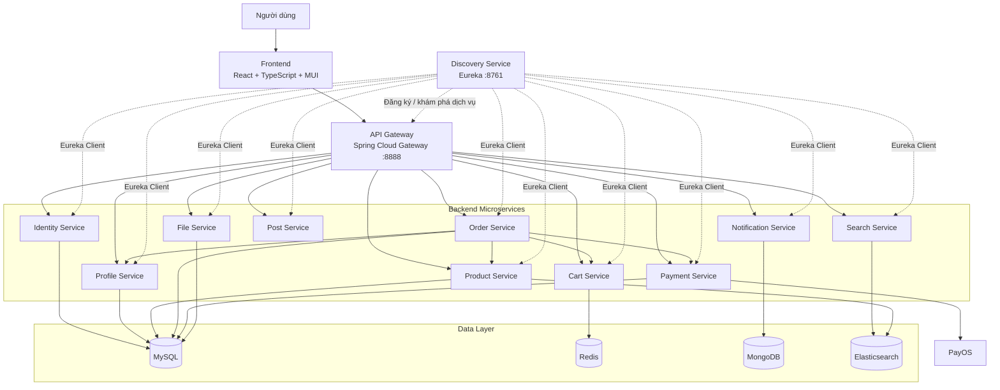
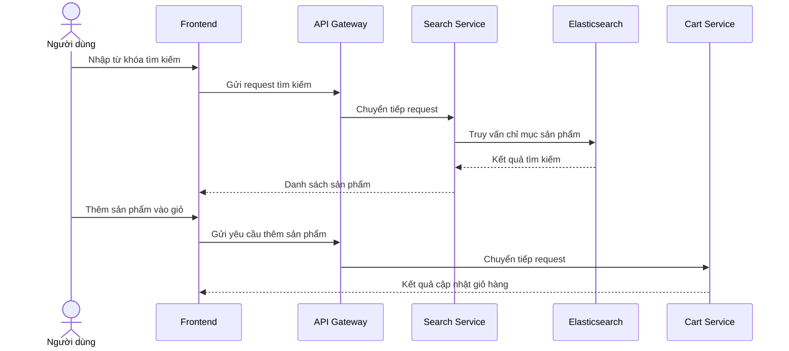
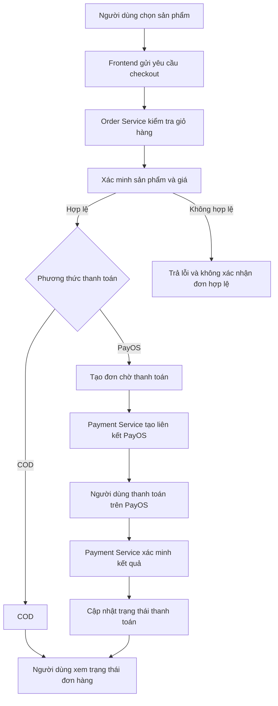
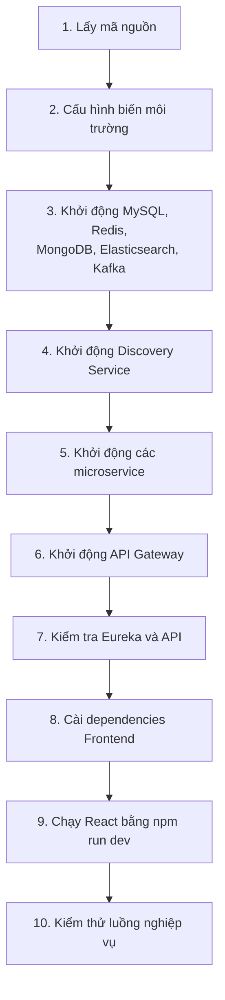

# SHOP-MEAL

**Hệ thống đặt món ăn trực tuyến xây dựng theo kiến trúc Microservices**

Shop-Meal là hệ thống đặt món ăn trực tuyến cho phép người dùng tìm kiếm sản phẩm, quản lý giỏ hàng, đặt hàng, thanh toán trực tuyến và theo dõi đơn hàng. Hệ thống được xây dựng theo kiến trúc Microservices, sử dụng Spring Boot cho Backend và React + TypeScript cho Frontend.

## 1. Architecture tổng thể

### 1.1. Kiến trúc hệ thống

Shop-Meal được tổ chức thành các lớp chính:

- **Presentation Layer:** Giao diện người dùng được xây dựng bằng React + TypeScript.
- **API Gateway Layer:** Tiếp nhận request từ frontend và định tuyến đến các microservice.
- **Service Layer:** Các microservice đảm nhiệm từng nghiệp vụ độc lập.
- **Service Discovery Layer:** Eureka hỗ trợ đăng ký và khám phá dịch vụ.
- **Data Layer:** Các hệ quản trị dữ liệu phù hợp với từng service.
- **External Services:** PayOS phục vụ thanh toán trực tuyến và các hệ thống tích hợp khác.

### 1.2. Sơ đồ kiến trúc tổng thể



*Lưu ý: Sơ đồ thể hiện kiến trúc logic mục tiêu. Kết nối dữ liệu và giao tiếp giữa các service cần được đối chiếu với cấu hình thực tế của từng module. Eureka chỉ hỗ trợ khám phá dịch vụ, không trực tiếp xử lý request nghiệp vụ.*

### 1.3. Vai trò các thành phần

| Thành phần | Vai trò |
|---|---|
| Frontend | Giao diện tìm kiếm món ăn, giỏ hàng, đặt hàng và quản lý tài khoản |
| API Gateway | Điểm truy cập tập trung, định tuyến và áp dụng các chính sách bảo vệ API |
| Discovery Service | Đăng ký và khám phá các microservice bằng Eureka |
| Identity Service | Đăng ký, đăng nhập và xác thực người dùng |
| Profile Service | Quản lý hồ sơ và thông tin người dùng |
| Product Service | Quản lý món ăn, giá và thông tin sản phẩm |
| Search Service | Tìm kiếm sản phẩm bằng Elasticsearch |
| File Service | Xử lý tải lên và cung cấp hình ảnh |
| Notification Service | Quản lý và gửi thông báo theo chức năng được triển khai |
| Cart Service | Quản lý giỏ hàng và các sản phẩm được chọn |
| Post Service | Quản lý bài viết liên quan đến sản phẩm |
| Order Service | Tạo đơn hàng và quản lý vòng đời đơn hàng |
| Payment Service | Quản lý giao dịch và tích hợp PayOS |

### 1.4. Công nghệ sử dụng

| Nhóm | Công nghệ |
|---|---|
| Backend | Java, Spring Boot |
| Microservices | Spring Cloud, OpenFeign |
| Service Discovery | Netflix Eureka |
| API Gateway | Spring Cloud Gateway |
| Bảo mật | Spring Security, JWT |
| ORM | Spring Data JPA, Hibernate |
| Cơ sở dữ liệu quan hệ | MySQL |
| Cache / giỏ hàng | Redis |
| Cơ sở dữ liệu tài liệu | MongoDB |
| Tìm kiếm | Elasticsearch |
| Giao tiếp bất đồng bộ | Apache Kafka, ở các luồng đã tích hợp |
| Thanh toán | PayOS |
| Frontend | React, TypeScript, Vite |
| UI | Material UI (MUI) |
| HTTP Client | Axios |
| Build Backend | Maven |
| Build Frontend | npm |

## 2. Sơ đồ luồng nghiệp vụ

### 2.1. Luồng tìm kiếm và lựa chọn sản phẩm



### 2.2. Luồng đặt hàng và thanh toán



**Nguyên tắc quan trọng:** Backend phải tự tính lại tổng tiền, xác minh dữ liệu đơn hàng và xác thực kết quả thanh toán. Frontend không được tự quyết định đơn hàng đã thanh toán thành công.

## 3. Yêu cầu cần đạt được của dự án

### 3.1. Yêu cầu chức năng

- Người dùng có thể đăng ký, đăng nhập và đăng xuất.
- Người dùng có thể xem, tìm kiếm và xem chi tiết món ăn.
- Người dùng có thể thêm, cập nhật số lượng và xóa sản phẩm trong giỏ hàng.
- Người dùng có thể đặt hàng và lựa chọn phương thức thanh toán được hỗ trợ.
- Hệ thống hỗ trợ quy trình thanh toán PayOS khi được cấu hình đầy đủ.
- Người dùng có thể xem lịch sử và chi tiết đơn hàng của mình.
- Hệ thống quản lý trạng thái đơn hàng và trạng thái thanh toán riêng biệt.
- Người dùng có thể quản lý hồ sơ theo các quyền được cấp.
- Hệ thống hỗ trợ quản lý bài viết, hình ảnh và thông báo theo phạm vi đã triển khai.
- Nhân viên hoặc quản trị viên có thể thực hiện các thao tác nghiệp vụ theo quyền hạn.

### 3.2. Yêu cầu phi chức năng

**Bảo mật**
- Xác thực request được bảo vệ bằng JWT.
- Kiểm tra quyền truy cập ở backend.
- Người dùng không được xem hoặc sửa dữ liệu thuộc người khác nếu không có quyền.
- Không lưu khóa API, mật khẩu hoặc secret trong mã nguồn công khai.
- Xác minh tính hợp lệ của webhook thanh toán.

**Tính nhất quán dữ liệu**
- Tính toán giá và tổng tiền tại backend.
- Lưu thông tin sản phẩm tại thời điểm đặt hàng.
- Xử lý yêu cầu thanh toán lặp một cách an toàn.
- Có phương án xử lý khi giao tiếp giữa các microservice thất bại.

**Khả năng bảo trì và mở rộng**
- Phân chia nghiệp vụ thành các microservice.
- Quản lý cấu hình theo môi trường.
- Tổ chức mã nguồn rõ ràng, dễ kiểm thử và mở rộng.
- Có thể triển khai nhiều instance cho các service khi cần.

**Trải nghiệm người dùng**
- Giao diện dễ sử dụng và tương thích với nhiều kích thước màn hình.
- Có thông báo rõ ràng khi request đang xử lý, thành công hoặc thất bại.
- Các trang cần xác thực được bảo vệ phù hợp.
- Hiển thị trạng thái đơn hàng và thanh toán từ backend.

### 3.3. Tiêu chí nghiệm thu tổng thể

- [ ] Backend khởi động được với cấu hình môi trường hợp lệ.
- [ ] Các microservice đã cấu hình Eureka đăng ký thành công.
- [ ] API Gateway định tuyến request đúng.
- [ ] Các API chính hoạt động và có kiểm tra xác thực, phân quyền.
- [ ] Frontend kết nối được với API Gateway.
- [ ] Người dùng thực hiện được luồng đăng nhập, tìm kiếm và quản lý giỏ hàng.
- [ ] Tạo đơn COD thành công với dữ liệu hợp lệ.
- [ ] Luồng PayOS hoạt động trong môi trường được cấu hình và kiểm thử.
- [ ] Trạng thái thanh toán chỉ được cập nhật sau khi xác minh.
- [ ] Các tình huống lỗi và dữ liệu không hợp lệ được xử lý phù hợp.
- [ ] Frontend build thành công cho môi trường production.
- [ ] README và cấu hình chạy dự án được cập nhật.

## 4. Yêu cầu môi trường

Trước khi chạy Shop-Meal, cần chuẩn bị:

- Git.
- JDK đúng phiên bản dự án yêu cầu.
- Maven hoặc Maven Wrapper (`mvnw`) đi kèm dự án.
- Node.js và npm.
- Các dịch vụ hạ tầng theo cấu hình thực tế: MySQL, Redis, MongoDB, Elasticsearch và Kafka nếu các module đang sử dụng.
- Các biến môi trường cần thiết cho kết nối database, Eureka, Kafka, Elasticsearch, JWT và PayOS.

Kiểm tra phiên bản công cụ:

```bash
java -version
mvn -version
node -v
npm -v
git --version
```

Nếu repository có Maven Wrapper, ưu tiên sử dụng `./mvnw` để dùng phiên bản Maven đã cấu hình cho dự án.

## 5. Cách chạy Backend

### 5.1. Lấy mã nguồn

```bash
git clone <REPOSITORY_URL>
cd shop-meal
```

Thay `<REPOSITORY_URL>` bằng địa chỉ repository thực tế.

Nếu đã có mã nguồn trên máy, chỉ cần chuyển đến thư mục dự án:

```bash
cd ~/Documents/backend/shop-meal
```

### 5.2. Khởi động hạ tầng

Khởi động các dịch vụ hạ tầng mà project đang sử dụng:

- MySQL.
- Redis.
- MongoDB.
- Elasticsearch.
- Kafka và các thành phần liên quan nếu cần.

Nếu repository có file `docker-compose.yml` hoặc `compose.yaml` dành cho hạ tầng, kiểm tra nội dung và sử dụng file đó:

```bash
docker compose up -d
docker compose ps
```

Chỉ chạy lệnh này tại thư mục chứa file Compose phù hợp. Nếu Compose chỉ khai báo một phần hạ tầng, các thành phần còn lại cần được khởi động riêng.

### 5.3. Cấu hình môi trường

Kiểm tra các file `application.yml`, `application.properties` và các cấu hình theo profile của từng service.

Cần xác nhận tối thiểu:

- Thông tin kết nối database.
- Địa chỉ Eureka Server.
- Địa chỉ Redis, MongoDB, Elasticsearch và Kafka.
- Các khóa JWT hoặc cấu hình xác thực.
- Các thông tin PayOS nếu muốn kiểm thử thanh toán.
- Các port và context path của từng service.

Không commit file chứa secret hoặc thông tin xác thực thật lên Git.

### 5.4. Thứ tự khởi động Backend

Khởi động các service theo thứ tự gợi ý:

1. Hạ tầng dữ liệu và message broker.
2. Discovery Service.
3. Các service nghiệp vụ: Identity, Profile, Product, File, Notification, Search, Cart và Post.
4. Payment Service.
5. Order Service.
6. API Gateway.

Thứ tự này giúp giảm lỗi do service gọi đến thành phần chưa sẵn sàng. Một số module có thể khởi động song song nếu dependency đã hoạt động.

### 5.5. Chạy từng Spring Boot service

Mở terminal tại thư mục của service cần chạy.

Nếu có Maven Wrapper:

```bash
chmod +x mvnw
./mvnw spring-boot:run
```

Hoặc nếu đã cài Maven tương thích:

```bash
mvn spring-boot:run
```

Có thể build module trước khi chạy:

```bash
./mvnw clean package
```

Nếu dự án sử dụng Maven parent ở thư mục gốc và cấu hình multi-module, kiểm tra `pom.xml` trước khi build toàn bộ repository. Nếu mỗi service là một project Maven riêng, thực hiện lệnh trong thư mục của từng service.

### 5.6. Kiểm tra sau khi khởi động

| Thành phần | Địa chỉ tham khảo |
|---|---|
| Discovery Service | `http://localhost:8761` |
| API Gateway | `http://localhost:8888` |
| Identity Service | Theo cấu hình service |
| Product Service | Theo cấu hình service |
| Search Service | Theo cấu hình service |
| Order Service | Theo cấu hình service |
| Payment Service | Theo cấu hình service |

Đối chiếu port và context path trong file cấu hình thực tế. Nếu API được gọi thông qua Gateway, hãy sử dụng URL và prefix mà Gateway đã khai báo thay vì suy ra endpoint chỉ từ port của service.

Sau khi khởi động, kiểm tra dashboard Eureka và gửi thử các request API bằng Postman.

## 6. Cách chạy Frontend React + TypeScript

### 6.1. Di chuyển đến thư mục frontend

```bash
cd ~/Documents/backend/shop-meal/web-app
```

Nếu frontend nằm ở vị trí khác, hãy dùng đường dẫn tương ứng với repository.

### 6.2. Cài đặt dependencies

```bash
npm install
```

Nếu repository có `package-lock.json`, có thể dùng `npm ci` để cài đặt theo lockfile:

```bash
npm ci
```

Chỉ sử dụng `npm ci` khi lockfile hiện có đồng bộ với `package.json`.

### 6.3. Cấu hình biến môi trường

Tạo file `.env` trong thư mục frontend theo các biến mà mã nguồn hiện tại sử dụng.

Ví dụ:

```env
VITE_API_BASE_URL=http://localhost:8888/api/v1
```

Đường dẫn trên là ví dụ. Hãy đối chiếu với `vite.config.ts`, cấu hình Axios và route của API Gateway để xác định base URL đúng.

Lưu ý: biến có tiền tố `VITE_` được đưa vào mã frontend khi build. Không đặt mật khẩu database, API key bí mật hoặc secret của PayOS trong file `.env` frontend.

### 6.4. Chạy chế độ phát triển

```bash
npm run dev
```

Vite sẽ hiển thị địa chỉ truy cập trong terminal, thường là:

`http://localhost:5173`

Sử dụng đúng địa chỉ mà terminal hiển thị nếu port mặc định đã được sử dụng.

### 6.5. Build Frontend

Kiểm tra các script có trong `package.json`, sau đó chạy:

```bash
npm run build
```

Nếu dự án có script kiểm tra kiểu dữ liệu riêng, chạy thêm script tương ứng, ví dụ:

```bash
npx tsc --noEmit
```

Lệnh này chỉ phù hợp nếu cấu hình TypeScript hiện tại hỗ trợ kiểm tra theo cách đó.

## 7. Trình tự chạy toàn bộ hệ thống



Sau khi hệ thống sẵn sàng, thực hiện kiểm thử theo thứ tự:

1. Truy cập frontend.
2. Đăng ký hoặc đăng nhập.
3. Xem và tìm kiếm sản phẩm.
4. Thêm sản phẩm vào giỏ hàng.
5. Tạo đơn hàng COD.
6. Thử quy trình PayOS trong môi trường đã cấu hình.
7. Kiểm tra lịch sử đơn hàng và trạng thái thanh toán.

## 8. Lưu ý khi phát triển và triển khai

- Giữ thống nhất tên service giữa Eureka, Gateway và OpenFeign.
- Đảm bảo mỗi service sử dụng đúng database hoặc kho dữ liệu theo thiết kế.
- Không phụ thuộc vào việc người dùng chỉ thao tác qua giao diện để bảo vệ dữ liệu; mọi API cần kiểm tra quyền ở backend.
- Không đánh dấu thanh toán thành công chỉ dựa trên redirect từ PayOS.
- Không lưu secret trong repository hoặc bundle frontend.
- Cấu hình CORS, HTTPS và các chính sách bảo mật phù hợp trước khi triển khai production.
- Kiểm tra các biến môi trường và dependency trước khi xử lý lỗi khởi động.
- Thường xuyên cập nhật tài liệu khi API, port hoặc luồng nghiệp vụ thay đổi.

## 9. Kết luận

Shop-Meal áp dụng kiến trúc Microservices nhằm phân tách các nghiệp vụ thành những thành phần độc lập, dễ phát triển và bảo trì. Eureka hỗ trợ khám phá dịch vụ, API Gateway cung cấp điểm truy cập tập trung, các microservice xử lý nghiệp vụ và quản lý dữ liệu, còn React + TypeScript cung cấp giao diện tương tác cho người dùng.

Mục tiêu cuối cùng là xây dựng một hệ thống đặt món ăn có quy trình mua hàng rõ ràng, bảo mật phù hợp, dữ liệu nhất quán và khả năng mở rộng khi bổ sung tính năng mới.
