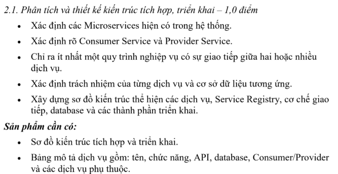

# Câu 1.1. Phân biệt Provider Service và Consumer Service trong kiến trúc hướng dịch vụ

## 1. Provider Service là gì?

Provider Service (dịch vụ cung cấp) là một dịch vụ chịu trách nhiệm cung cấp các chức năng nghiệp vụ thông qua API để những dịch vụ khác có thể sử dụng.

Đặc điểm:
- Cung cấp API (REST API, gRPC,...) cho các dịch vụ khác.
- Tiếp nhận và xử lý request từ Consumer.
- Trả về response chứa dữ liệu hoặc kết quả xử lý.
- Quản lý logic nghiệp vụ và dữ liệu thuộc phạm vi trách nhiệm của mình.

Ví dụ trong hệ thống Shop Meal:
- Product Service cung cấp API quản lý và truy vấn sản phẩm.
- Identity Service cung cấp API đăng nhập, đăng ký và xác thực người dùng.
- Profile Service cung cấp API quản lý thông tin cá nhân.
- Payment Service cung cấp API xử lý thanh toán.

## 2. Consumer Service là gì?

Consumer Service (dịch vụ tiêu thụ) là dịch vụ sử dụng API do Provider Service cung cấp để thực hiện chức năng nghiệp vụ của chính nó.

Đặc điểm:
- Gửi request đến API của Provider.
- Tiếp nhận và xử lý response.
- Không cần biết chi tiết cách Provider triển khai logic bên trong.
- Có thể sử dụng REST API, OpenFeign hoặc HTTP Client để giao tiếp.

Ví dụ trong hệ thống Shop Meal:
- Order Service là Consumer khi gọi Product Service để lấy thông tin sản phẩm.
- Order Service là Consumer khi gọi Profile Service để lấy thông tin khách hàng.
- Search Service là Consumer khi nhận dữ liệu sản phẩm được đồng bộ từ Product Service.

**Lưu ý:** Một Microservice có thể vừa là Provider vừa là Consumer tùy thuộc vào chức năng đang thực hiện.

## 3. Các bước cơ bản khi Consumer gọi API của Provider

Quá trình giao tiếp giữa hai dịch vụ được thực hiện như sau:

**Bước 1: Xác định Provider**

Consumer xác định dịch vụ cung cấp API cần sử dụng thông qua Service ID hoặc địa chỉ API.

**Bước 2: Gửi Request**

Consumer tạo HTTP Request, bao gồm:
- HTTP Method: GET, POST, PUT, DELETE.
- URL của API.
- Header: Authorization, Content-Type,...
- Request Body nếu cần thiết.

**Bước 3: Provider tiếp nhận Request**

Provider nhận request, kiểm tra dữ liệu đầu vào, xác thực và phân quyền nếu cần thiết.

**Bước 4: Xử lý nghiệp vụ**

Provider thực hiện logic nghiệp vụ, truy vấn hoặc cập nhật cơ sở dữ liệu.

**Bước 5: Trả Response**

Provider trả về HTTP Response gồm:
- HTTP Status Code.
- Response Header.
- Response Body chứa dữ liệu hoặc thông báo lỗi.

**Bước 6: Consumer xử lý Response**

Consumer kiểm tra kết quả trả về, sau đó tiếp tục xử lý nghiệp vụ hoặc trả kết quả cho client.

## 4. Xử lý khi Provider không phản hồi hoặc trả về lỗi

Để hệ thống Microservices hoạt động ổn định, Consumer cần có các cơ chế xử lý lỗi:

- **Timeout:** Thiết lập thời gian chờ tối đa. Nếu Provider không phản hồi trong thời gian quy định, Consumer kết thúc request để tránh chờ vô hạn.
- **Retry:** Thử gửi lại request khi xảy ra lỗi tạm thời. Cần giới hạn số lần thử lại và sử dụng backoff.
- **Circuit Breaker:** Khi Provider liên tục gặp lỗi, ngắt tạm thời các request để tránh làm quá tải hệ thống. Sau một khoảng thời gian, cho phép thử kết nối lại.
- **Fallback:** Cung cấp kết quả thay thế hoặc thông báo phù hợp khi Provider không thể phục vụ.
- **Logging:** Ghi lại thông tin lỗi để phục vụ việc theo dõi và khắc phục sự cố.
- **Exception Handling:** Bắt và xử lý ngoại lệ, không để lỗi từ Provider làm sập toàn bộ hệ thống.

Đối với những thao tác làm thay đổi dữ liệu hoặc thanh toán, cần đặc biệt chú ý đến tính idempotent để tránh xử lý trùng lặp khi Retry.

## 5. Liên hệ thực tế với hệ thống Shop Meal

Trong Shop Meal, khi khách hàng đặt món, Order Service cần lấy thông tin sản phẩm từ Product Service.

- Product Service đóng vai trò Provider.
- Order Service đóng vai trò Consumer.

Quy trình:
1. Khách hàng gửi yêu cầu đặt hàng.
2. Order Service nhận request.
3. Order Service sử dụng OpenFeign gọi API của Product Service để lấy thông tin sản phẩm.
4. Product Service truy vấn cơ sở dữ liệu MySQL và trả về thông tin sản phẩm.
5. Order Service kiểm tra dữ liệu, tính toán tổng tiền và tạo đơn hàng.
6. Nếu Product Service không phản hồi, Order Service xử lý Timeout, Retry hoặc trả thông báo lỗi phù hợp.

**Kết luận:** Provider chịu trách nhiệm cung cấp dịch vụ, còn Consumer sử dụng dịch vụ đó. Hai thành phần giao tiếp với nhau thông qua API, giúp các Microservices độc lập trong triển khai và phát triển.

## Cau 2 lam cau 2.1

