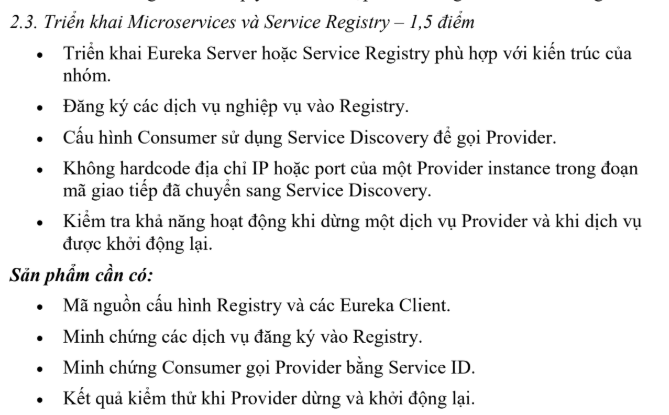

# Câu 1.2. Vai trò của Service Registry và Service Discovery trong kiến trúc Microservices

## 1. Service Registry là gì?

Service Registry (bộ đăng ký dịch vụ) là nơi lưu trữ thông tin của các Microservices đang hoạt động trong hệ thống.

Thông tin đăng ký thường bao gồm:
- Service ID hoặc Service Name.
- Địa chỉ IP.
- Port.
- Trạng thái hoạt động.
- Metadata của dịch vụ.

Khi một Microservice khởi động, nó đăng ký thông tin của mình vào Service Registry. Trong quá trình hoạt động, dịch vụ gửi Heartbeat để thông báo rằng nó vẫn đang hoạt động.

Nếu dịch vụ ngừng hoạt động hoặc không gửi Heartbeat trong khoảng thời gian quy định, Registry có thể đánh dấu hoặc loại bỏ instance đó khỏi danh sách khả dụng.

## 2. Service Discovery là gì?

Service Discovery (cơ chế tìm kiếm dịch vụ) là cơ chế cho phép một Microservice tìm kiếm địa chỉ của Microservice khác thông qua Service Registry.

Thay vì phải cấu hình địa chỉ IP và Port cố định, Consumer chỉ cần biết Service ID của Provider.

Quy trình:
1. Provider khởi động và đăng ký thông tin với Service Registry.
2. Consumer cần gọi Provider.
3. Consumer sử dụng Service ID để tìm kiếm Provider.
4. Service Discovery trả về danh sách các instance khả dụng.
5. Consumer lựa chọn một instance để gửi request.
6. Request được gửi đến Provider và nhận response.

## 3. Phân biệt Service Registry và Service Discovery

| Tiêu chí | Service Registry | Service Discovery |
|---|---|---|
| Bản chất | Nơi lưu trữ thông tin dịch vụ | Cơ chế tìm kiếm dịch vụ |
| Chức năng | Đăng ký và quản lý instance | Tìm địa chỉ instance |
| Đối tượng sử dụng | Provider đăng ký thông tin | Consumer tìm kiếm Provider |
| Kết quả | Danh sách dịch vụ đã đăng ký | Địa chỉ dịch vụ cần gọi |
| Vai trò | Quản lý danh sách dịch vụ | Hỗ trợ giao tiếp động |

## 4. Phân biệt Eureka Server và API Gateway

### Eureka Server

Eureka Server là một Service Registry được cung cấp bởi Netflix Eureka, thường được sử dụng trong hệ sinh thái Spring Cloud.

Chức năng:
- Tiếp nhận đăng ký từ các Microservices.
- Lưu trữ thông tin các service instance.
- Nhận Heartbeat để theo dõi trạng thái đăng ký.
- Cung cấp danh sách dịch vụ để Consumer tìm kiếm.
- Hỗ trợ phát hiện các instance có thể sử dụng.

### API Gateway

API Gateway là cổng giao tiếp trung gian giữa Client và hệ thống Microservices.

Chức năng:
- Tiếp nhận request từ Client.
- Định tuyến request đến Microservice tương ứng.
- Xác thực và phân quyền.
- Áp dụng Rate Limiting.
- Xử lý CORS và các chính sách bảo mật.
- Có thể tích hợp Load Balancing khi định tuyến đến nhiều instance.

### Bảng so sánh

| Tiêu chí | Eureka Server | API Gateway |
|---|---|---|
| Vai trò | Service Registry | Cổng giao tiếp |
| Chức năng chính | Đăng ký và khám phá dịch vụ | Định tuyến request |
| Đối tượng giao tiếp | Các Microservices | Client và Microservices |
| Xác thực người dùng | Không phải chức năng chính | Có thể thực hiện |
| Load Balancing | Cung cấp thông tin instance | Có thể thực hiện định tuyến cân bằng tải |
| Tiếp nhận request từ Client | Không | Có |

**Lưu ý:** Eureka Server không thay thế API Gateway. Hai thành phần có nhiệm vụ khác nhau và thường được sử dụng kết hợp.

## 5. Tại sao Consumer nên gọi Provider thông qua Service ID thay vì IP hoặc URL cố định?

Có các lý do sau:

- **Tính linh hoạt:** Địa chỉ IP và Port có thể thay đổi khi triển khai lại dịch vụ, nhưng Service ID vẫn giữ nguyên.
- **Khả năng mở rộng:** Một dịch vụ có thể chạy nhiều instance trên các máy chủ khác nhau.
- **Load Balancing:** Có thể phân phối request đến nhiều instance để tránh quá tải một máy chủ.
- **High Availability:** Khi một instance gặp sự cố, hệ thống có thể lựa chọn instance khác đang hoạt động.
- **Giảm cấu hình thủ công:** Không cần cập nhật địa chỉ IP trong từng Consumer khi Provider thay đổi địa chỉ.

## 6. Liên hệ thực tế với hệ thống Shop Meal

Trong dự án Shop Meal, hệ thống sử dụng Spring Cloud Netflix Eureka và Spring Cloud Gateway.

Các thành phần chính:

| Service | Service ID | Port |
|---|---|---|
| Discovery Service | discovery-service | 8761 |
| API Gateway | api-gateway | 8888 |
| Identity Service | identity-service | 8080 |
| Profile Service | profile-service | 8081 |
| Product Service | product-service | 8083 |
| Search Service | search-service | 8084 |
| Payment Service | payment-service | 8087 |
| File Service | file-service | 8088 |

Ví dụ: Khi Order Service cần lấy thông tin sản phẩm, nó sử dụng OpenFeign với tên dịch vụ `product-service`.

Thay vì gọi trực tiếp:

`http://192.168.1.10:8083/api/products`

Consumer có thể gọi thông qua Service ID:

`http://product-service/api/products`

Spring Cloud LoadBalancer kết hợp với Eureka hỗ trợ tìm kiếm và lựa chọn instance phù hợp.

**Kết luận:** Service Registry lưu trữ thông tin dịch vụ, Service Discovery tìm kiếm dịch vụ. Eureka Server đảm nhiệm đăng ký và khám phá, còn API Gateway đảm nhiệm tiếp nhận và định tuyến request. Sự kết hợp này giúp Shop Meal linh hoạt, dễ mở rộng và giảm phụ thuộc vào địa chỉ IP cố định.

## Cau 2 lam phan 2.3

