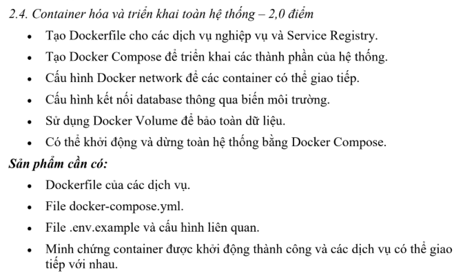

# Câu 1.3. Phân biệt Docker Image và Docker Container

## 1. Docker Image là gì?

Docker Image là một mẫu đóng gói chứa những thành phần cần thiết để chạy một ứng dụng.

Một Image thường bao gồm:
- Hệ điều hành hoặc môi trường nền tối thiểu.
- Runtime như JRE, Python,...
- Các thư viện và dependencies.
- Source code hoặc file thực thi của ứng dụng.
- Cấu hình khởi chạy ứng dụng.

Đặc điểm:
- Có tính bất biến sau khi được tạo.
- Có thể sử dụng để tạo nhiều Container.
- Có thể được lưu trữ và chia sẻ thông qua Docker Hub hoặc Registry riêng.
- Được xây dựng từ Dockerfile.

Ví dụ trong Shop Meal: Image của Product Service chứa môi trường Java và file JAR của Product Service.

## 2. Docker Container là gì?

Docker Container là một thực thể được tạo ra từ Docker Image và đang hoặc đã được chạy.

Container cung cấp môi trường cô lập để ứng dụng hoạt động.

Đặc điểm:
- Được tạo từ Docker Image.
- Có thể khởi động, dừng, khởi động lại hoặc xóa.
- Có môi trường mạng và filesystem riêng.
- Có thể sử dụng Volume để lưu trữ dữ liệu lâu dài.
- Nhiều Container có thể được tạo từ cùng một Image.

Ví dụ trong Shop Meal: Container `product-service` được tạo từ Image của Product Service để chạy ứng dụng.

## 3. Phân biệt Docker Image và Docker Container

| Tiêu chí | Docker Image | Docker Container |
|---|---|---|
| Bản chất | Bản mẫu ứng dụng | Instance chạy từ Image |
| Trạng thái | Không chạy trực tiếp | Có thể đang chạy hoặc dừng |
| Khả năng thay đổi | Các layer được thiết kế bất biến | Có filesystem ghi riêng |
| Số lượng | Một Image | Nhiều Container từ cùng Image |
| Tạo ra bằng | Dockerfile và docker build | docker run hoặc docker create |
| Quản lý | docker images | docker ps |

Ví dụ:
- `shop-meal-product:latest` là Docker Image.
- `product-service` là Docker Container được tạo từ Image đó.

## 4. Dockerfile là gì?

Dockerfile là file chứa các chỉ dẫn để Docker xây dựng Docker Image.

Vai trò:
- Xác định Image nền.
- Cài đặt môi trường chạy ứng dụng.
- Sao chép file cần thiết vào Image.
- Khai báo thư mục làm việc.
- Cấu hình lệnh khởi chạy ứng dụng.

Ví dụ Dockerfile cho một Spring Boot Microservice trong Shop Meal:

```dockerfile
FROM eclipse-temurin:25-jre

WORKDIR /app

COPY target/product-service.jar app.jar

EXPOSE 8083

ENTRYPOINT ["java", "-jar", "app.jar"]
```

Giải thích:
- FROM: Chọn môi trường Java Runtime.
- WORKDIR: Thiết lập thư mục làm việc.
- COPY: Sao chép file JAR vào Image.
- EXPOSE: Khai báo port ứng dụng sử dụng.
- ENTRYPOINT: Xác định lệnh chạy ứng dụng.

Lưu ý: Tên file JAR và phiên bản Java phải phù hợp với cấu hình thực tế của service.

## 5. Docker Compose là gì?

Docker Compose là công cụ cho phép định nghĩa và quản lý nhiều Container trong cùng một hệ thống thông qua file YAML, thường là `docker-compose.yml`.

Vai trò:
- Khởi chạy nhiều Microservices cùng lúc.
- Khai báo các dịch vụ và Image.
- Thiết lập port và environment variables.
- Cấu hình Docker Network để các Container giao tiếp.
- Khai báo Volume để lưu trữ dữ liệu.
- Thiết lập thứ tự phụ thuộc giữa các dịch vụ.
- Hỗ trợ quản lý toàn bộ hệ thống bằng một số lệnh đơn giản.

Ví dụ Docker Compose trong Shop Meal:

```yaml
services:
  discovery-service:
    image: shop-meal/discovery-service:latest
    ports:
      - "8761:8761"

  api-gateway:
    image: shop-meal/api-gateway:latest
    ports:
      - "8888:8888"
    depends_on:
      - discovery-service

  product-service:
    image: shop-meal/product-service:latest
    ports:
      - "8083:8083"
    depends_on:
      - discovery-service
```

Đây là ví dụ minh họa cấu hình triển khai, chưa bao gồm toàn bộ dependencies và cấu hình môi trường của hệ thống thực tế.

## 6. Liên hệ thực tế với Shop Meal

Shop Meal là hệ thống Microservices gồm nhiều dịch vụ như:
- API Gateway.
- Discovery Service.
- Identity Service.
- Profile Service.
- Product Service.
- Search Service.
- Cart Service.
- Order Service.
- Payment Service.
- File Service.
- Post Service.
- Notification Service.

Nếu triển khai thủ công, chúng ta phải khởi chạy từng service, cấu hình môi trường và quản lý kết nối giữa các dịch vụ.

Khi sử dụng Docker:
1. Mỗi Microservice được đóng gói thành một Docker Image.
2. Docker Container được tạo ra từ Image tương ứng.
3. Các Container được kết nối thông qua Docker Network.
4. Các cơ sở dữ liệu và dịch vụ phụ trợ có thể được triển khai thành những Container riêng.
5. Docker Compose quản lý việc khởi chạy và kết nối các thành phần.

Các lệnh thường sử dụng:

```bash
# Build Image
docker build -t shop-meal/product-service .

# Liệt kê Image
docker images

# Khởi chạy Container
docker run -d --name product-service shop-meal/product-service

# Liệt kê Container đang chạy
docker ps

# Khởi chạy toàn bộ hệ thống bằng Compose
docker compose up -d

# Dừng hệ thống
docker compose down
```

**Kết luận:** Docker Image là bản mẫu dùng để tạo ứng dụng, Docker Container là môi trường chạy ứng dụng từ Image. Dockerfile dùng để xây dựng Image, còn Docker Compose giúp triển khai và quản lý nhiều Container trong hệ thống Microservices một cách thuận tiện.

## Cau 2 lam phan 2.4

