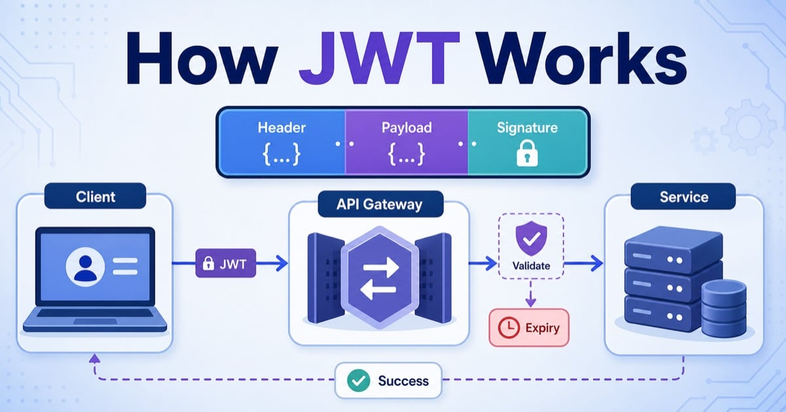

# Ý 3. Xác thực và phân quyền dịch vụ

## 1. Authentication và Authorization

Trong hệ thống Shop Meal, xác thực và phân quyền là hai cơ chế bảo mật quan trọng:

- **Authentication (Xác thực):** Xác minh danh tính người dùng. Ví dụ: kiểm tra email và mật khẩu khi người dùng đăng nhập.
- **Authorization (Phân quyền):** Kiểm tra những tài nguyên hoặc chức năng mà người dùng đã xác thực được phép truy cập. Ví dụ: CUSTOMER được đặt hàng, còn ADMIN được quản lý sản phẩm.

| Tiêu chí | Authentication | Authorization |
|---|---|---|
| Mục đích | Xác minh người dùng là ai | Xác định người dùng được làm gì |
| Thời điểm | Trước khi cấp quyền | Sau khi danh tính được xác minh |
| Ví dụ | Đăng nhập bằng email, mật khẩu | Kiểm tra vai trò ADMIN khi tạo sản phẩm |

## 2. JWT là gì?

**JWT (JSON Web Token)** là định dạng token gọn nhẹ dùng để truyền tải thông tin dưới dạng JSON giữa các bên. JWT thường được sử dụng để xác thực API theo cơ chế Stateless Authentication.

Một JWT gồm ba phần, được ngăn cách bởi dấu chấm (`.`):

1. **Header:** Chứa loại token và thuật toán ký.
2. **Payload:** Chứa các thông tin như mã người dùng, vai trò và thời gian hết hạn.
3. **Signature:** Chữ ký dùng để kiểm tra tính toàn vẹn và nguồn gốc của token.

> Payload của JWT thường chỉ được mã hóa Base64URL, không mặc nhiên được mã hóa bí mật. Không đưa mật khẩu hoặc dữ liệu nhạy cảm vào payload.

## 3. Quy trình sử dụng JWT để bảo vệ API



Quy trình hoạt động:

1. Người dùng nhập email và mật khẩu trên Client, sau đó gửi thông tin đăng nhập đến Identity Service.
2. Identity Service kiểm tra thông tin tài khoản.
3. Nếu thông tin hợp lệ, Identity Service phát hành JWT chứa thông tin định danh và quyền của người dùng.
4. Client nhận token và gửi kèm token trong HTTP Header của những request cần xác thực:

   ```http
   Authorization: Bearer <access_token>
   ```

5. API Gateway kiểm tra tính hợp lệ của JWT, chẳng hạn chữ ký và thời hạn sử dụng.
6. Nếu token hợp lệ, request được chuyển đến Microservice tương ứng. Tại đây, hệ thống tiếp tục kiểm tra quyền của người dùng.
7. Nếu người dùng đủ quyền, API thực hiện nghiệp vụ và trả kết quả.

Ví dụ request tạo sản phẩm:

```http
POST /api/v1/product
Authorization: Bearer <access_token>
Content-Type: application/json
```

API tạo sản phẩm chỉ cho phép người dùng có vai trò `ADMIN`. Người dùng `USER` dù đã đăng nhập thành công vẫn không được phép thực hiện chức năng này.

## 4. Phân biệt HTTP 401 và HTTP 403

| Mã trạng thái | Ý nghĩa | Ví dụ trong Shop Meal |
|---|---|---|
| **401 Unauthorized** | Request chưa được xác thực hợp lệ | Người dùng chưa đăng nhập, token sai hoặc đã hết hạn |
| **403 Forbidden** | Đã xác thực nhưng không có quyền thực hiện | USER gọi API chỉ dành cho ADMIN |

Cách ghi nhớ:

- **401:** Hệ thống chưa xác minh được danh tính hợp lệ của request.
- **403:** Hệ thống đã xác minh danh tính nhưng từ chối quyền truy cập.

## 5. Liên hệ với hệ thống Shop Meal

Shop Meal được xây dựng theo kiến trúc Microservices, sử dụng Spring Boot, Spring Security, JWT và API Gateway để bảo vệ các API.

| Vai trò | Một số quyền tiêu biểu |
|---|---|
| `USER` | Xem sản phẩm, quản lý giỏ hàng, đặt hàng và theo dõi đơn hàng cá nhân |
| `STAFF` | Tiếp nhận và cập nhật trạng thái đơn hàng theo quyền được cấp |
| `ADMIN` | Quản lý sản phẩm, danh mục, người dùng và đơn hàng |

Trách nhiệm của các thành phần:

- **Identity Service:** Tiếp nhận yêu cầu đăng nhập, xác thực tài khoản và phát hành JWT.
- **API Gateway:** Là điểm tiếp nhận request từ Client, kiểm tra JWT trước khi định tuyến đến dịch vụ phía sau.
- **Các Microservice:** Thực hiện nghiệp vụ và kiểm tra quyền truy cập phù hợp với chức năng được bảo vệ.

**Tình huống minh họa:** Một người dùng có vai trò `CUSTOMER` đăng nhập thành công và nhận JWT. Khi người dùng gửi request đến API tạo sản phẩm, hệ thống xác thực token thành công nhưng phát hiện người dùng không có quyền `ADMIN`. Vì vậy, request bị từ chối với HTTP `403 Forbidden`.

## 6. Kết luận

Authentication giúp xác minh danh tính người dùng, còn Authorization giúp kiểm soát quyền truy cập sau khi xác thực. Kết hợp JWT, Spring Security và API Gateway giúp Shop Meal bảo vệ API, hỗ trợ giao tiếp giữa các Microservice và hạn chế người dùng truy cập trái phép vào những chức năng không thuộc quyền hạn của mình.
